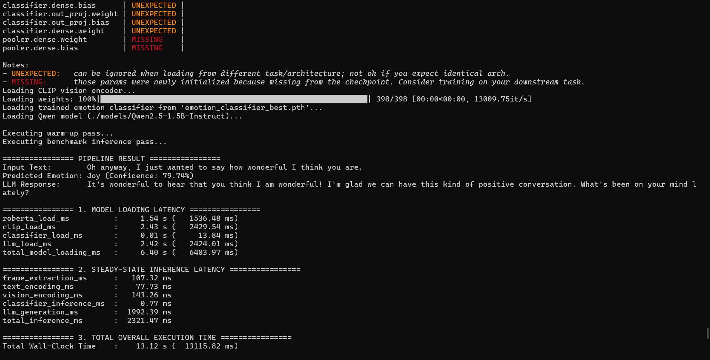
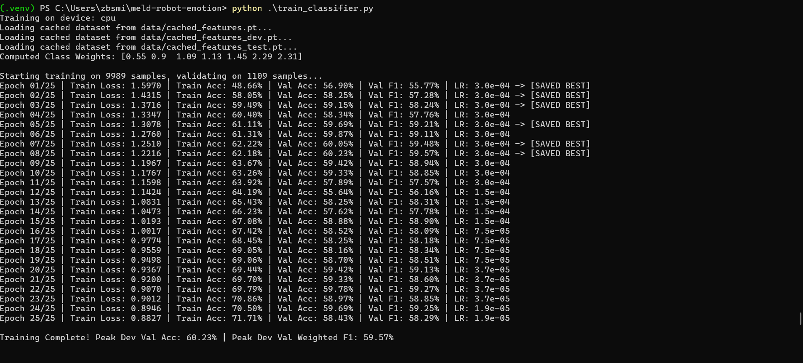
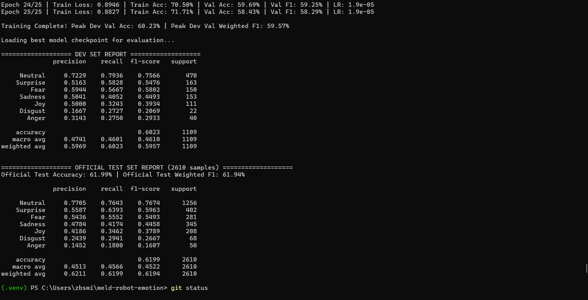

# Multimodal Emotion-Aware Response Pipeline (MELD)

A text + vision pipeline that classifies the emotion behind a conversational utterance and generates an empathetic reply, built on the [Multimodal EmotionLines Dataset (MELD)](https://affective-meld.github.io/) with frozen pretrained encoders, a small trained classifier, and a 4-bit quantized local LLM. Everything runs on a laptop CPU.

> **Status: prototype.** I built this under a tight deadline for an ML challenge. It runs end to end, but it is missing the experiments needed to support stronger claims (see [Known gaps](#known-gaps-and-planned-fixes)). I plan to address these in a future update.



## What it does

For each MELD utterance (text plus its recorded video clip), the pipeline:

1. Extracts the middle frame of the clip with OpenCV.
2. Encodes the text with `cardiffnlp/twitter-roberta-base-emotion` (768-D, mean-pooled over tokens).
3. Encodes the frame with `openai/clip-vit-base-patch32` (512-D, L2-normalized).
4. Concatenates both into a 1280-D vector and classifies it with an MLP into one of MELD's 7 emotions, with a softmax confidence.
5. Passes the utterance and predicted emotion to `Qwen2.5-1.5B-Instruct` (4-bit GGUF via `llama-cpp-python`) to generate a short empathetic reply.
6. Logs the latency of each stage.

The encoders are frozen. Only the MLP head is trained.

```text
Text  ──► RoBERTa (768-D) ─────────────────┐
                                           ├──► Concatenate (1280-D) ──► MLP ──► Emotion + confidence ──► Qwen2.5-1.5B ──► Reply
Video ──► middle frame ──► CLIP (512-D) ───┘
```

**Input is recorded video, not a live stream.** The pipeline processes completed MELD video files one utterance at a time. It does not yet take live camera or microphone input.

## Models and parameter budget

The challenge capped the full system at 6B learned parameters.

| Component | Model | Approx. parameters |
|---|---|---:|
| Text encoder | `cardiffnlp/twitter-roberta-base-emotion` | ~125M |
| Vision encoder | `openai/clip-vit-base-patch32` (full checkpoint loaded) | ~151M |
| Classifier head | `MultimodalEmotionClassifier` (1280 → 512 → 128 → 7) | ~0.72M |
| LLM | `Qwen2.5-1.5B-Instruct` (Q4_K_M GGUF) | ~1.54B |
| **Total** | | **~1.82B** |

## Training

- **Features:** cached once per split by `extract_features.py`, so training runs on a CPU in minutes.
- **Data:** official MELD splits: 9,989 train, 1,109 dev, 2,610 test utterances.
- **Classifier:** 3 linear layers with BatchNorm, ReLU, and dropout (0.5, then 0.35).
- **Imbalance:** cross-entropy with square-root-smoothed inverse class-frequency weights.
- **Optimization:** AdamW (learning rate 3e-4, weight decay 0.01), batch size 128, 25 epochs, with the learning rate halved when dev weighted F1 stops improving.
- **Model selection:** the checkpoint with the best dev-set weighted F1 is saved (epoch 8 in the reported run). The test split is evaluated once, after training.

After about epoch 8, training accuracy kept rising (to ~72%) while dev accuracy stayed near 58–60%, so the head starts overfitting early.

## Results

These are from a single training run with no fixed random seed, so I can't report variance yet.

| Split | Accuracy | Weighted F1 | Macro F1 |
|---|---:|---:|---:|
| Dev (1,109) | 60.23% | 59.57% | 46.10% |
| **Test (2,610)** | **61.99%** | **61.94%** | **45.22%** |

Per-class results on the test split:

| Emotion | Precision | Recall | F1 | Support |
|---|---:|---:|---:|---:|
| Neutral | 0.7705 | 0.7643 | 0.7674 | 1256 |
| Joy | 0.5587 | 0.6393 | 0.5963 | 402 |
| Surprise | 0.5436 | 0.5552 | 0.5493 | 281 |
| Anger | 0.4784 | 0.4174 | 0.4458 | 345 |
| Sadness | 0.4186 | 0.3462 | 0.3789 | 208 |
| Disgust | 0.2439 | 0.2941 | 0.2667 | 68 |
| Fear | 0.1452 | 0.1800 | 0.1607 | 50 |

> **Correction:** the original version of this table (and the dev/test reports in the training screenshots) had the wrong emotion names on 5 of the 7 rows. `extract_features.py` encodes labels as Neutral, Joy, Surprise, Anger, Sadness, Disgust, Fear, but `train_classifier.py` printed its report with a different name order. The numbers and the overall scores were never affected. Only the row names were wrong. The script now uses the same order, and the support counts above match MELD's official test-set class counts.

The gap between weighted and macro F1 comes from MELD's class imbalance: the model does well on Neutral and poorly on the rarer classes (Disgust, Fear), despite class weighting.

**Context and what these results don't show:**

- **There is no text-only baseline yet,** so these results do not show how much the vision branch contributes. The text encoder is already fine-tuned for emotion, so text may be doing most of the work.

### Latency (CPU only)

Measured on an AMD Ryzen 5 3500U (4 cores), 12 GB shared RAM, Windows 11, Python 3.12, for one utterance (a single timed run after one warm-up pass):

| Stage | Latency |
|---|---:|
| Frame extraction | 107 ms |
| Text encoding (RoBERTa) | 78 ms |
| Vision encoding (CLIP) | 143 ms |
| Classification (MLP) | 0.8 ms |
| Response generation (Qwen, 4-bit, up to 50 tokens) | 1,992 ms |
| **Total per utterance** | **~2.3 s** |

Loading all models took about 6.4 s. LLM generation is about 86% of the latency. An unquantized PyTorch LLM took roughly 68 s per response on this machine, which is why I switched to a 4-bit GGUF model.

At ~2.3 s per turn on a CPU, this is not real-time conversation, which typically needs well under a second. It is a latency baseline for a resource-constrained setup.

## Design decisions

- **Middle frame instead of the full clip.** One CLIP pass per utterance keeps compute and memory low. The cost is that it misses expression changes across the utterance, and in multi-person scenes the middle frame may not show the speaker's face.
- **Early fusion by concatenation.** A simple way to let a small classifier combine text and visual features without training a larger multimodal model.
- **Frozen encoders and cached features.** Embeddings are computed once per split, so the classifier can be retrained quickly on a CPU.
- **4-bit quantized LLM.** Makes it practical to run the LLM alongside both encoders in 12 GB of RAM.

## Known gaps and planned fixes

I built this under the challenge's time limit and prioritized getting a complete, working pipeline. Feedback after submission pointed out gaps in experimental rigor, which I agree with. I plan to address them in a future update:

| Gap | Planned fix |
|---|---|
| No text-only baseline or modality ablation | Train text-only and vision-only heads on the same cached features and compare them with the fused model on the test split |
| Per-class results were mislabeled | Fixed in this README and in `train_classifier.py`. Next: define the label list in one shared module so the scripts can't disagree |
| No repeated experiments | Fix random seeds and report mean ± standard deviation over several runs |
| No data-quality analysis | Count clips that fail to load (these currently fall back to a zero vision vector), check how often the middle frame shows the speaker's face, and inspect misclassified examples |
| No saved prediction artifacts | Save per-utterance predictions and probabilities to a CSV so results can be checked without retraining |
| No evaluation of LLM responses | Score replies for emotion consistency and appropriateness on a sample, with a written rubric and human or LLM-assisted ratings |
| Recorded video framed as real-time | Add a live webcam/microphone mode, and report streaming latency separately from offline clip processing |

## Other limitations

- **No audio.** The pipeline uses text and vision only, although tone of voice carries a lot of emotional information in MELD.
- **Single-utterance context.** Neither the classifier nor the LLM sees the conversation history.
- **LLM variability.** Replies are sampled (temperature 0.7) and vary between runs, and they may not always match the predicted emotion.

## Setup

**Requires Python 3.12.** The pinned packages (e.g. `numpy==2.5.2`) do not install on Python 3.11 or earlier. Tested on Windows 11.

```powershell
git clone https://github.com/zachbs/meld-robot-emotion.git
cd meld-robot-emotion
py -3.12 -m venv .venv
.\.venv\Scripts\Activate.ps1
pip install -r requirements.txt
```

Notes for Windows:
- If activation fails with "running scripts is disabled", run `Set-ExecutionPolicy -Scope Process -ExecutionPolicy Bypass` first.
- `llama-cpp-python` builds from source by default, which needs Visual Studio Build Tools (C++ workload). Without them, the build fails with `CMAKE_C_COMPILER not set`. To skip compiling, install a prebuilt CPU wheel first, then the rest of the requirements:
  ```powershell
  pip install llama-cpp-python==0.3.35 --only-binary=:all: --extra-index-url https://abetlen.github.io/llama-cpp-python/whl/cpu
  pip install -r requirements.txt
  ```
- If the install fails with a "No such file or directory" error on a very long path, enable Windows long paths or point `TMP`/`TEMP` to a short folder such as `C:\t` before installing.

Download the quantized LLM into `models/`:

```powershell
huggingface-cli download Qwen/Qwen2.5-1.5B-Instruct-GGUF qwen2.5-1.5b-instruct-q4_k_m.gguf --local-dir models
```

Or set `GGUF_PATH` in `pipeline.py` to wherever you keep the model.

Download MELD from the [official site](https://affective-meld.github.io/) and extract it to `data/MELD.Raw/`. The dataset is not included in this repo.

## Usage

1. **Cache features.** Run `extract_features.py` three times, setting `dataset = 0`, `1`, then `2` at the top of the file (train, dev, test). This writes `data/cached_features_train.pt`, `_dev.pt`, and `_test.pt`.
2. **Train and evaluate.** Run `python train_classifier.py`. It saves `emotion_classifier_best.pth` and prints the dev and test reports.
3. **Run the pipeline.** Run `python pipeline.py`. It classifies one MELD test clip and prints the reply and per-stage latency. A trained `emotion_classifier_best.pth` is included, so you can skip steps 1–2 for this.

## Repository structure

```text
meld-robot-emotion/
├── pipeline.py              # end-to-end inference with per-stage latency
├── extract_features.py      # caches text and vision embeddings per split
├── train_classifier.py      # trains the MLP head, reports dev and test results
├── emotion_classifier_best.pth
├── requirements.txt
├── assets/                  # screenshots from real runs
├── data/                    # MELD and cached features go here (not tracked)
└── models/                  # GGUF LLM goes here (not tracked)
```

## Training logs

| Epoch log (train and dev metrics) | Dev and test reports |
|:---:|:---:|
|  |  |

These screenshots are from the original run, so their per-class reports show the old, incorrect emotion names. The corrected names are in [Results](#results).
